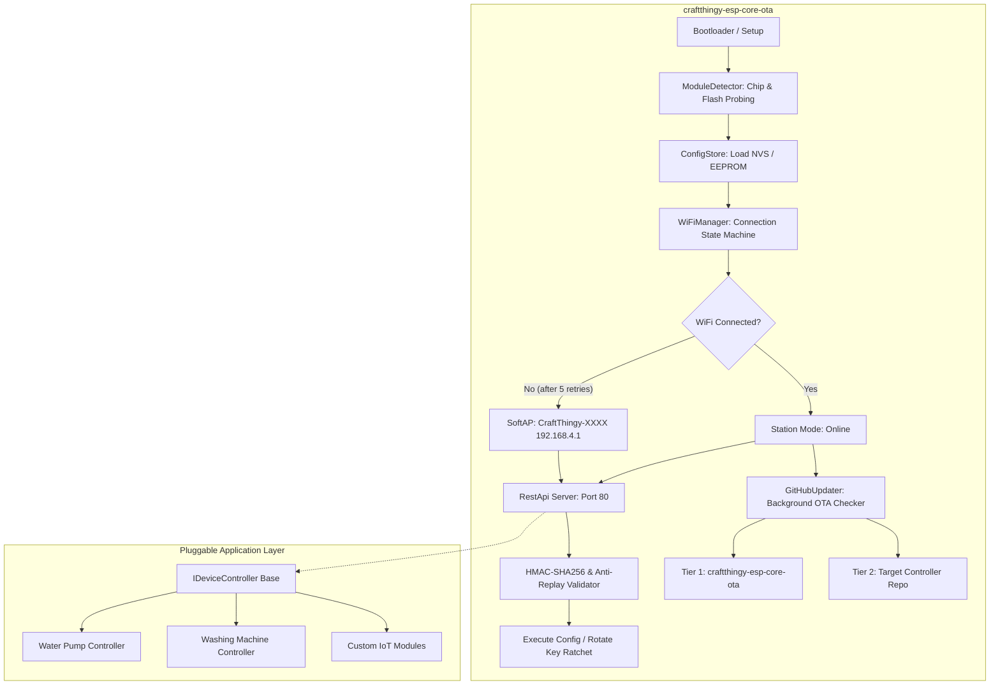

# CraftThingy ESP Core OTA Framework (`craftthingy-esp-core-ota`)

[]()
[]()
[]()
[]()

The foundational embedded framework for the **CraftThingy Digital Innovation** ecosystem. Provides self-updating capabilities, dynamic WiFi provisioning with failover AP, military-grade API security with rolling keys, and pluggable hardware controller interfaces.

Optimized specifically for strict memory and flash limits on **ESP-01 / ESP-01S (1MB Flash, ~35KB Free RAM)** and all **ESP32 variants (ESP32, S2, S3, C3, C6)**.

---

## 📑 Table of Contents
1. [Architecture Overview](#-architecture-overview)
2. [Hardware Constraint Engineering (ESP-01 1MB Flash)](#-hardware-constraint-engineering-esp-01-1mb-flash)
3. [Cryptographic Security & Rolling Key Ratchet](#-cryptographic-security--rolling-key-ratchet)
4. [WiFi Failover & Provisioning State Machine](#-wifi-failover--provisioning-state-machine)
5. [Two-Tier GitHub OTA Engine](#-two-tier-github-ota-engine)
6. [REST API Reference (Port 80)](#-rest-api-reference-port-80)
7. [Pluggable Controller Interface (`IDeviceController`)](#-pluggable-controller-interface-idevicecontroller)
8. [Building & Flashing in Arduino IDE](#-building--flashing-in-arduino-ide)
9. [Building & Flashing in PlatformIO](#-building--flashing-in-platformio)
10. [Automated CI/CD Workflow](#-automated-cicd-workflow)

---

## 🏛 Architecture Overview



---

## ⚡ Hardware Constraint Engineering (ESP-01 1MB Flash)

ESP-01 and ESP-01S modules have severe constraints:
- **Flash Size**: 1048576 bytes (1 Megabyte).
- **2-Slot OTA Limit**: Flash must contain the running sketch *plus* space for the incoming sketch. This caps the compiled binary size at **~480 KB - 512 KB**.
- **RAM**: ~80 KB total, with only ~35 KB free heap after WiFi initialization.

### How this framework fits and runs efficiently:
1. **Zero-HTML REST API**: Web pages, HTML strings, and CSS stylesheets are completely removed from flash. The entire API communicates in compact JSON. This saves **30 KB+ of flash**.
2. **BearSSL TLS Buffer Tuning**: Standard BearSSL allocates 16 KB in + 16 KB out buffers (= 32 KB RAM), which crashes the ESP8266. We set:
   ```cpp
   client.setBufferSizes(1024, 1024);
   ```
   This reduces TLS RAM consumption to under **5 KB**, allowing stable HTTPS connections to GitHub!
3. **Streaming JSON Parser**: Releases on GitHub contain 20 KB+ of JSON. Loading that into a `String` causes immediate out-of-memory crashes. Our parser processes characters as they arrive from the network using only **256 bytes of stack memory**, scanning for target assets on the fly.
4. **Direct-to-Flash Streaming**: Firmware binaries stream directly from HTTP chunks into `Update.write(buf, len)`. The binary is never held in RAM.

---

## 🔐 Cryptographic Security & Rolling Key Ratchet

Sensitive API endpoints (WiFi configuration, GitHub target reconfiguration, manual OTA triggers, reboot) require authorization.

### 1. Request Signature Algorithm
Incoming requests must include:
- `X-Timestamp`: Current UTC Unix epoch timestamp.
- `X-Nonce`: 8-byte random hexadecimal string.
- `X-Sequence`: Monotonically increasing sequence number.
- `X-Signature`: HMAC-SHA256 signature calculated over:
  ```text
  METHOD\nPATH\nTIMESTAMP\nNONCE\nBODY
  ```
  Using the current rolling key.

### 2. Rolling Key Ratchet (Forward Secrecy)
After any configuration change (or via `/api/v1/security/rotate-key`), the device derives the next key using:
$$K_{n+1} = \text{HMAC-SHA256}(K_n, \text{"CRAFT\_ROLL\_KEY\_"} + n)$$
The old key is permanently erased from flash memory. If an attacker intercepts a past request, they cannot forge future commands.

### 3. Anti-Replay Protection
- Timestamps skewed by more than ±300 seconds are rejected.
- Monotonic sequence numbers must be strictly greater than the last recorded sequence.
- A 16-entry ring buffer caches recently seen nonces to block replay attempts.

---

## 📡 WiFi Failover & Provisioning State Machine

1. **Boot**: Attempts connection to saved WiFi credentials.
2. **Retry Mechanism**: Tries up to 5 times (12 seconds per attempt) with exponential backoff.
3. **Failover to SoftAP**: If connection fails or no WiFi is saved, launches SoftAP:
   - SSID: `CraftThingy-XXXX` (where `XXXX` is the last 4 characters of the MAC address).
   - IP: `192.168.4.1`.
   - Starts DNS Captive Portal server on port 53.
4. **Background Reconnect**: While in AP mode, every 60 seconds the device silently tests if the saved WiFi has reappeared. If found, it reconnects automatically.

---

## 🔄 Two-Tier GitHub OTA Engine

The updater checks two distinct tiers on GitHub:

```text
Check Trigger (Timer or API)
  │
  ├──► Tier 1: Core Framework (craftthingy-esp-core-ota)
  │    └── Compares local CRAFT_CORE_VERSION with latest release tag.
  │        If newer, downloads and flashes core firmware.
  │
  └──► Tier 2: Application Controller (e.g. craftthingy-esp-water-pump)
       └── Compares local controller version with latest release tag.
           If newer, downloads and flashes application firmware.
```

### GitHub 302 Redirect Following
GitHub release asset URLs redirect (HTTP 302) to AWS S3 (`objects.githubusercontent.com`). The updater automatically follows up to 4 redirects, preserving the TLS stream and writing directly to flash partitions.

---

## 🌐 Standardized REST API Specification (`v1`, Port 80)

All endpoints follow an industry-standard RESTful schema with **mandatory authentication** across all routes (including telemetry and WiFi scans) to prevent unauthorized surveillance or physical machinery manipulation. Responses are formatted with a consistent **JSend envelope**:

### Standard Response Envelope
```json
// Success Response (HTTP 200)
{
  "status": "success",
  "code": 200,
  "uptime": 1420,
  "data": { ... }
}

// Error Response (HTTP 400 / 401 / 404 / 500)
{
  "status": "error",
  "code": 401,
  "uptime": 1420,
  "error": {
    "message": "Unauthorized: Valid HMAC signature or Bearer token required",
    "reason": "invalid_signature"
  }
}
```

### Endpoints Overview

| Method | Endpoint | Description | Auth Required |
|---|---|---|---|
| `GET` | `/api/v1/system/status` | Comprehensive system, network, OTA & controller telemetry | **Yes** (HMAC / Bearer) |
| `POST` | `/api/v1/system/reboot` | Safely reboots the microcontroller | **Yes** (HMAC / Bearer) |
| `GET` | `/api/v1/device/status` | Live hardware controller metrics (e.g., pump state, water level) | **Yes** (HMAC / Bearer) |
| `POST` | `/api/v1/device/command` | Execute hardware commands (`interrupt`, `start`, `auto`, `reset_safety`) | **Yes** (HMAC / Bearer) |
| `GET` | `/api/v1/wifi/scan` | Scans nearby 2.4GHz WiFi SSIDs and signal strengths | **Yes** (HMAC / Bearer) |
| `POST` | `/api/v1/wifi/config` | Saves SSID/password and connects in background | **Yes** (HMAC / Bearer) |
| `POST` | `/api/v1/github/config` | Updates target GitHub repos and ratchets rolling key | **Yes** (HMAC / Bearer) |
| `POST` | `/api/v1/ota/check` | Triggers immediate GitHub release check and OTA flash | **Yes** (HMAC / Bearer) |
| `POST` | `/api/v1/security/rotate-key` | Advances HMAC rolling key ratchet for forward secrecy | **Yes** (HMAC / Bearer) |
| `POST` | `/api/v1/security/update-token` | Updates master secret Bearer token in persistent storage | **Yes** (HMAC / Bearer) |
| `POST` | `/api/v1/security/seed-key` | Re-seeds the rolling key ratchet with a new base key & counter | **Yes** (HMAC / Bearer) |

*(Note: Legacy unversioned routes `/api/...` remain available as backward-compatible aliases).*

---

### 1. `GET /api/v1/system/status`
Returns complete device metrics, networking, OTA targets, and attached controller state.
- **Headers**: `X-Signature`, `X-Timestamp`, `X-Nonce`, `X-Sequence` OR `Authorization: Bearer <key>`
- **Response**:
```json
{
  "status": "success",
  "code": 200,
  "uptime": 342,
  "data": {
    "system": {
      "status": "online",
      "coreVersion": "1.0.0",
      "boardTarget": "esp01s",
      "chip": "ESP8266 (ESP-01S 1MB)",
      "flashBytes": 1048576,
      "freeHeap": 36840,
      "mac": "84:F3:EB:12:34:56"
    },
    "network": {
      "state": "connected",
      "ip": "192.168.1.105",
      "ssid": "Home-Network"
    },
    "ota": {
      "status": "Firmware Up to Date",
      "org": "CraftThingy-Digital-Innovation",
      "coreRepo": "craftthingy-esp-core-ota",
      "controllerRepo": "craftthingy-esp-water-pump",
      "activeRole": "water_pump"
    },
    "security": {
      "rollingSequence": 3,
      "currentRollingKeyPrefix": "a1b2c3d4..."
    },
    "device": {
      "role": "water_pump",
      "pumpRunning": true,
      "interrupted": false,
      "autoMode": true,
      "tankDemandsFill": true,
      "dryRunAlarm": false,
      "runDurationSec": 45,
      "maxRunTimeSec": 900
    }
  }
}
```

### 2. `GET /api/v1/device/status` (Alias: `/api/v1/pump/status`)
Returns hardware controller telemetry directly.
- **Auth**: HMAC Rolling Key or Bearer Token
- **Response**:
```json
{
  "status": "success",
  "code": 200,
  "uptime": 342,
  "data": {
    "role": "water_pump",
    "pumpRunning": false,
    "interrupted": false,
    "autoMode": true,
    "tankDemandsFill": false,
    "dryRunAlarm": false,
    "runDurationSec": 0,
    "maxRunTimeSec": 900
  }
}
```

### 3. `POST /api/v1/device/command` (Alias: `/api/v1/pump/command`)
Executes immediate operational controls on the pump or appliance.
- **Auth**: HMAC Rolling Key or Bearer Token
- **Payload (`JSON` or form parameters)**:
```json
{
  "cmd": "interrupt"
}
```
Available commands:
- `interrupt` (or `stop`, `off`): **Immediate emergency stop**. Cuts relay power instantly and disables auto-mode.
- `start` (or `on`): Manually forces pump relay ON.
- `auto` (or `resume`): Clears manual/interrupted states and returns to autonomous float switch sensing.
- `reset_safety`: Resets the 15-minute dry-run safety lockout alarm.

### 4. `GET /api/v1/wifi/scan`
Scans and lists nearby wireless networks.
- **Auth**: HMAC Rolling Key or Bearer Token
- **Response**:
```json
{
  "status": "success",
  "code": 200,
  "uptime": 345,
  "data": [
    {"ssid": "Home-Network", "rssi": -55, "enc": true},
    {"ssid": "Workshop", "rssi": -72, "enc": true}
  ]
}
```

### 5. `POST /api/v1/wifi/config`
Configures WiFi credentials and attempts immediate background connection.
- **Auth**: HMAC Rolling Key or Bearer Token
- **Payload**:
```json
{
  "ssid": "Home-Network",
  "pass": "SecretPassword123"
}
```

### 6. `POST /api/v1/github/config`
Reconfigures target GitHub organization, repositories, and role, automatically advancing the rolling key ratchet for forward secrecy.
- **Auth**: HMAC Rolling Key or Bearer Token
- **Payload**:
```json
{
  "org": "CraftThingy-Digital-Innovation",
  "core_repo": "craftthingy-esp-core-ota",
  "controller_repo": "craftthingy-esp-water-pump",
  "role": "water_pump",
  "token": ""
}
```

### 7. `POST /api/v1/ota/check`
Forces an immediate dual-tier GitHub release check and OTA flash.
- **Auth**: HMAC Rolling Key or Bearer Token

### 8. `POST /api/v1/security/rotate-key`
Manually advances the rolling key ratchet forward by one sequence.
- **Auth**: HMAC Rolling Key or Bearer Token

### 9. `POST /api/v1/security/update-token`
Updates the static master secret key / Tier 2 Bearer token in wear-leveled flash storage (EEPROM/NVS).
- **Auth**: HMAC Rolling Key or existing Bearer Token
- **Payload**:
```json
{
  "token": "MyNewSecureSuperSecretKey2026!"
}
```
- **Response**:
```json
{
  "status": "success",
  "code": 200,
  "uptime": 450,
  "data": {
    "message": "Master Bearer token updated successfully",
    "tokenPrefix": "MyNe..."
  }
}
```

### 10. `POST /api/v1/security/seed-key`
Re-seeds the HMAC-SHA256 rolling key ratchet engine with a custom base key/seed and resets the sequence counter.
- **Auth**: HMAC Rolling Key or Bearer Token
- **Payload**:
```json
{
  "seed": "e1f2a3b4c5d60718293a4b5c6d7e8f90112233445566778899aabbccddeeff11",
  "sequence": 1,
  "sync_master": true
}
```
- **Response**:
```json
{
  "status": "success",
  "code": 200,
  "uptime": 452,
  "data": {
    "message": "Rolling key ratchet re-seeded successfully",
    "startingSequence": 1,
    "syncedMaster": true,
    "keyPrefix": "e1f2a3b4..."
  }
}
```

### 11. `POST /api/v1/system/reboot`
Safely restarts the microcontroller.
- **Auth**: HMAC Rolling Key or Bearer Token

---

## 🔌 Pluggable Controller Interface (`IDeviceController`)

Custom hardware modules implement the clean abstract interface in [`DeviceController.h`](file:///d:/CraftThingy/esp-stuff/craftthingy-esp-core-ota/lib/CraftThingyCore/src/DeviceController.h):

```cpp
class IDeviceController {
public:
    virtual void setup() = 0;
    virtual void loop() = 0;
    virtual const char* getRoleName() const = 0;
    virtual const char* getAppVersion() const = 0;
    virtual bool handleCommand(const String& cmd, const String& payload, String& response) = 0;
    virtual String getStatusJson() = 0;
};
```

---

## 🔨 Building & Flashing in Arduino IDE

1. Open Arduino IDE.
2. Select **File → Open** and open [`craftthingy-esp-core-ota.ino`](file:///d:/CraftThingy/esp-stuff/craftthingy-esp-core-ota/craftthingy-esp-core-ota.ino).
3. Board Settings:
   - **For ESP-01 / ESP-01S**:
     - Board: `Generic ESP8266 Module`
     - Flash Size: `1MB (FS:64KB OTA:~470KB)`
     - Upload Speed: `115200`
   - **For ESP32**:
     - Board: Your ESP32 board (e.g. `ESP32 Dev Module`)
     - Partition Scheme: `Minimal SPIFFS (1.9MB APP with OTA)`
4. Click **Upload**.

---

## 💻 Building & Flashing in PlatformIO

```bash
# Build standalone core for ESP-01 / ESP-01S (1MB)
pio run -e esp01_1m

# Build for standard ESP32
pio run -e esp32dev

# Build for ESP32-S3
pio run -e esp32s3

# Build for ESP32-C3
pio run -e esp32c3

# Upload
pio run -e esp01_1m -t upload
```

---

## 🤖 Automated CI/CD Workflow

Pushing a version tag triggers [`.github/workflows/release.yml`](file:///d:/CraftThingy/esp-stuff/craftthingy-esp-core-ota/.github/workflows/release.yml):
```bash
git tag v1.0.0
git push origin v1.0.0
```
GitHub Actions compiles binaries for all board targets (`firmware-esp01s.bin`, `firmware-esp32.bin`, `firmware-esp32s3.bin`, `firmware-esp32c3.bin`), generates SHA-256 checksums, and attaches them to the GitHub Release.
