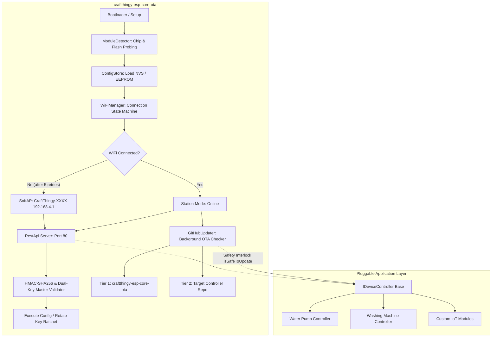

# CraftThingy ESP Core OTA Framework (`craftthingy-esp-core-ota`)

[]()
[]()
[]()
[]()

The foundational embedded framework for the **CraftThingy Digital Innovation** ecosystem. Provides self-updating capabilities, dynamic WiFi provisioning with failover AP, military-grade API security with rolling keys, critical-operation safety interlocks, and pluggable hardware controller interfaces.

Optimized specifically for strict memory and flash limits on **ESP-01 / ESP-01S (1MB Flash, ~35KB Free RAM)** and all **ESP32 variants (ESP32, S2, S3, C3, C6)**.

---

## 📑 Table of Contents
1. [Architecture Overview](#-architecture-overview)
2. [Hardware Constraint Engineering (ESP-01 1MB Flash)](#-hardware-constraint-engineering-esp-01-1mb-flash)
3. [Zero-Debris Module Switching (Clean In-Place Overwrite)](#-zero-debris-module-switching-clean-in-place-overwrite)
4. [Cryptographic Security & Rolling Key Ratchet](#-cryptographic-security--rolling-key-ratchet)
5. [Critical Operation Safety Interlock](#-critical-operation-safety-interlock)
6. [WiFi Failover & Provisioning State Machine](#-wifi-failover--provisioning-state-machine)
7. [Two-Tier GitHub OTA Engine](#-two-tier-github-ota-engine)
8. [Hardware Probing & Flashing Tool (`flash_tool.py`)](#-hardware-probing--flashing-tool-flash_toolpy)
9. [Operational Tooling Suite (`tools/`)](#-operational-tooling-suite-tools)
10. [Standardized REST API Reference (Port 80)](#-standardized-rest-api-reference-v1-port-80)
11. [Pluggable Controller Interface (`IDeviceController`)](#-pluggable-controller-interface-idevicecontroller)
12. [Building & Flashing in Arduino IDE](#-building--flashing-in-arduino-ide)
13. [Building & Flashing in PlatformIO](#-building--flashing-in-platformio)
14. [Automated CI/CD Workflow](#-automated-cicd-workflow)

---

## 🏛 Architecture Overview



---

## ⚡ Hardware Constraint Engineering (ESP-01 1MB Flash)

ESP-01 and ESP-01S modules have severe constraints:
- **Flash Size**: 1048576 bytes (1 Megabyte).
- **2-Slot OTA Limit**: Flash must contain the running sketch *plus* space for the incoming sketch. This caps the compiled binary size at **~480 KB - 512 KB**.
- **RAM**: ~80 KB total, with only ~35 KB free heap after WiFi initialization.

### How this framework fits and runs efficiently:
1. **Zero-HTML REST API**: Web pages, HTML strings, and CSS stylesheets are completely removed from flash. The entire API communicates in compact JSON. This saves **30 KB+ of flash**.
2. **BearSSL TLS Buffer Tuning**: Standard BearSSL allocates 16 KB in + 16 KB out buffers (= 32 KB RAM), which crashes the ESP8266. We set:
   ```cpp
   client.setBufferSizes(1024, 1024);
   ```
   This reduces TLS RAM consumption to under **5 KB**, allowing stable HTTPS connections to GitHub!
3. **Streaming JSON Parser**: Releases on GitHub contain 20 KB+ of JSON. Loading that into a `String` causes immediate out-of-memory crashes. Our parser processes characters as they arrive from the network using only **256 bytes of stack memory**, scanning for target assets on the fly.
4. **Direct-to-Flash Streaming**: Firmware binaries stream directly from HTTP chunks into `Update.write(buf, len)`. The binary is never held in RAM.

---

## 🧼 Zero-Debris Module Switching (Clean In-Place Overwrite)

A common concern when switching application modules dynamically over the air (e.g. converting a unit from a **Water Pump** to a **Washing Machine**) is leftover disk trash or deserted file fragments.

### How CraftThingy Guarantees Zero Leftover Files:
1. **No Fragmented Filesystem Storage**: Unlike an operating system (Linux / Windows) that extracts loose script or application files into directories, the ESP runs as a bare-metal microcontroller.
2. **Dual-Slot Flash Partition Architecture**:
   ```text
   Physical 1MB SPI Flash Layout:
   ┌──────────────────────┬──────────────────────┬──────────┬──────────┐
   │     OTA Slot 0       │     OTA Slot 1       │  EEPROM  │  System  │
   │      (~470 KB)       │      (~470 KB)       │  (4 KB)  │  (64 KB) │
   └──────────────────────┴──────────────────────┴──────────┴──────────┘
         ▲                      ▲
      Active                 Inactive
   (Running Pump)         (Target for Washing Machine)
   ```
3. **Monolithic Sector Overwrite**: When reconfigured via API (`POST /api/v1/github/config` with `role: "washing_machine"`), the updater downloads the new module's binary and writes directly into the **inactive flash partition**. The write process erases and overwrites each 4KB flash sector consecutively from byte 0.
4. **Atomic Pointer Swap**: Once SHA-256 verification completes, the bootloader's boot vector swaps active execution to the newly written partition.
5. **No Deserted Files**: When the module is changed again in the future, the older partition is completely overwritten. **Not a single byte of orphan code or file debris remains.**

---

## 🔐 Cryptographic Security & Rolling Key Ratchet

Sensitive API endpoints (WiFi configuration, GitHub target reconfiguration, manual OTA triggers, reboot, key rotation) require cryptographic authorization.

### 1. Request Signature Algorithm
Incoming requests must include:
- `X-Timestamp`: Current UTC Unix epoch timestamp.
- `X-Nonce`: 8-byte random hexadecimal string.
- `X-Sequence`: Monotonically increasing sequence number.
- `X-Signature`: HMAC-SHA256 signature calculated over:
  ```text
  METHOD\nPATH\nTIMESTAMP\nNONCE\nBODY
  ```
  Using the current active rolling key.

### 2. Rolling Key Ratchet (Forward Secrecy)
After any configuration change (or via `/api/v1/security/rotate-key`), the device derives the next key using:
$$K_{n+1} = \text{HMAC-SHA256}(K_n, \text{"CRAFT\_ROLL\_KEY\_"} + n)$$
The old key is permanently erased from flash memory. If an attacker intercepts a past request, they cannot forge future commands.

### 3. Dual-Key Master Protection
Changing the Master Secret Key (`POST /api/v1/security/update-master-key`) or re-seeding the key generator (`POST /api/v1/security/seed-key`) enforces **Dual-Key Authorization**:
- Must provide a valid HMAC signature using the active rolling key, **AND**
- Must supply the current Master Key (via header `X-Master-Key` or JSON body `current_master_key`).
Even if an attacker intercepts a single ephemeral rolling key, they cannot hijack the root master key.

### 4. Anti-Replay Protection
- Timestamps skewed by more than ±300 seconds are rejected.
- Monotonic sequence numbers must be strictly greater than the last recorded sequence.
- A 16-entry ring buffer caches recently seen nonces to block replay attempts.

---

## 🛡️ Critical Operation Safety Interlock

Updating firmware in the middle of active hardware operation can be dangerous (e.g. cutting off water pump mid-cycle, leaving valves stuck open, or corrupting state machines).

The core framework integrates hardware safety interlocks via [`IDeviceController`](file:///d:/CraftThingy/esp-stuff/craftthingy-esp-core-ota/lib/CraftThingyCore/src/DeviceController.h):
- **`isSafeToUpdate()`**: Before downloading or flashing any OTA binary, the core queries the active controller. If the pump is actively pumping or a wash cycle is running, the update is **immediately aborted or postponed** (`OTA_STATUS_POSTPONED`).
- **`prepareForUpdate()`**: If safe, the controller safely shuts down high-current relays and persists operational counters before the flasher begins writing to flash.

---

## 📡 WiFi Failover & Provisioning State Machine

1. **Boot**: Attempts connection to saved WiFi credentials.
2. **Retry Mechanism**: Tries up to 5 times (12 seconds per attempt) with exponential backoff.
3. **Failover to SoftAP**: If connection fails or no WiFi is saved, launches SoftAP:
   - SSID: `CraftThingy-XXXX` (where `XXXX` is the last 4 characters of the MAC address).
   - IP: `192.168.4.1`.
   - Starts DNS Captive Portal server on port 53.
4. **Background Reconnect**: While in AP mode, every 60 seconds the device silently tests if the saved WiFi has reappeared. If found, it reconnects automatically.

---

## 🔄 Two-Tier GitHub OTA Engine

The updater checks two distinct tiers on GitHub:

```text
Check Trigger (Timer or API)
  │
  ├──► Tier 1: Core Framework (craftthingy-esp-core-ota)
  │    └── Compares local CRAFT_CORE_VERSION with latest release tag.
  │        If newer, downloads and flashes core firmware.
  │
  └──► Tier 2: Application Controller (e.g. craftthingy-esp-water-pump)
       └── Compares local controller version with latest release tag.
           If newer, downloads and flashes application firmware.
```

### GitHub 302 Redirect Following
GitHub release asset URLs redirect (HTTP 302) to AWS S3 (`objects.githubusercontent.com`). The updater automatically follows up to 4 redirects, preserving the TLS stream and writing directly to flash partitions.

---

## ⚡ Hardware Probing & Flashing Tool (`flash_tool.py`)

A production-ready Python flasher located in [`tools/flash_tool.py`](file:///d:/CraftThingy/esp-stuff/craftthingy-esp-core-ota/tools/flash_tool.py) for probing silicon hardware, erasing flash, backing up memory, and flashing binaries.

### Installation:
```bash
pip install esptool pyserial
```

### 🚨 ESP-01 / ESP-01S Physical Bootstrapping Pinout:
Standard ESP-01 modules do not have automatic USB-UART reset transistors. To flash them:
1. **Unplug** the USB adapter from your PC.
2. **Bridge GPIO 0 to GND**:
   - If your adapter has a switch: Slide it to **`PROG`** (not `UART`).
   - If using wires/headers: Connect **GPIO 0 (Pin 5) to GND (Pin 1)**. Ensure **CH_PD / EN (Pin 4)** is connected to **3.3V (VCC)**.
3. **Plug the adapter back into your USB port** while holding GPIO 0 LOW. The chip enters UART download mode (`boot mode:(1,x)`).
4. Run your probe or flash command.
5. **After flashing completes**: Unplug, remove the GPIO 0 jumper (or slide switch back to `UART`), and plug back in to run.

### Flashing Tool Commands:
```bash
# 1. Probe connected hardware (auto-detects COM port, reads MAC, flash size, chip ID):
python tools/flash_tool.py probe

# 2. Probe with explicit COM port:
python tools/flash_tool.py --port COM17 probe

# 3. Flash compiled firmware to ESP-01 (1MB):
python tools/flash_tool.py flash --bin firmware-esp01s.bin

# 4. High-speed flashing with verify (460800 baud):
python tools/flash_tool.py --baud 460800 flash --bin firmware-esp01s.bin --verify

# 5. Erase entire SPI flash (clean factory wipe):
python tools/flash_tool.py erase

# 6. Backup existing 1MB flash contents to binary file:
python tools/flash_tool.py backup --out backup_esp01.bin --size 1MB
```

---

## 🧰 Operational Tooling Suite (`tools/`)

All provisioning, testing, and operational tools are located in [`tools/`](file:///d:/CraftThingy/esp-stuff/craftthingy-esp-core-ota/tools/):

1. **[`flash_tool.py`](./tools/flash_tool.py)**: Silicon probe, flash erase, memory backup, and binary flasher.
2. **[`esp_manager.html`](./tools/esp_manager.html)**: Zero-installation, single-file browser dashboard with WebCrypto HMAC-SHA256 calculations, live telemetry, WiFi scanner, and GitHub reconfiguration.
3. **[`craftthingy_esp_ctl.py`](./tools/craftthingy_esp_ctl.py)**: Developer CLI for scripting REST API calls, inspecting telemetry, emergency stopping pumps, and ratcheting keys.
4. **[`generate_release.py`](./tools/generate_release.py)**: Release packaging utility that renames build outputs to target board naming conventions and generates SHA-256 hashes.

---

## 🌐 Standardized REST API Reference (`v1`, Port 80)

All endpoints follow an industry-standard RESTful schema with **mandatory authentication** across all routes. Responses are formatted with a consistent **JSend envelope**:

### Standard Response Envelope
```json
// Success Response (HTTP 200)
{
  "status": "success",
  "code": 200,
  "uptime": 1420,
  "data": { ... }
}

// Error Response (HTTP 400 / 401 / 404 / 500)
{
  "status": "error",
  "code": 401,
  "uptime": 1420,
  "error": {
    "message": "Unauthorized: Valid HMAC signature or Bearer token required",
    "reason": "invalid_signature"
  }
}
```

### Endpoints Overview

| Method | Endpoint | Description | Auth Required |
|---|---|---|---|
| `GET` | `/api/v1/system/status` | Comprehensive system, network, OTA & controller telemetry | **Yes** (HMAC / Bearer) |
| `POST` | `/api/v1/system/reboot` | Safely reboots the microcontroller | **Yes** (HMAC / Bearer) |
| `GET` | `/api/v1/device/status` | Live hardware controller metrics (pump state, cycle status) | **Yes** (HMAC / Bearer) |
| `POST` | `/api/v1/device/command` | Execute hardware commands (`interrupt`, `start`, `auto`, `reset_safety`) | **Yes** (HMAC / Bearer) |
| `GET` | `/api/v1/wifi/scan` | Scans nearby 2.4GHz WiFi SSIDs and signal strengths | **Yes** (HMAC / Bearer) |
| `POST` | `/api/v1/wifi/config` | Saves SSID/password and connects in background | **Yes** (HMAC / Bearer) |
| `POST` | `/api/v1/github/config` | Updates target GitHub repos and ratchets rolling key | **Yes** (HMAC / Bearer) |
| `POST` | `/api/v1/ota/check` | Triggers immediate GitHub release check and OTA flash | **Yes** (HMAC / Bearer) |
| `POST` | `/api/v1/security/rotate-key` | Advances HMAC rolling key ratchet for forward secrecy | **Yes** (HMAC / Bearer) |
| `POST` | `/api/v1/security/update-token` | Updates master secret Bearer token in persistent storage | **Yes** (HMAC / Bearer) |
| `POST` | `/api/v1/security/update-master-key` | Updates Master Secret Key (enforces Dual-Key proof) | **Yes** (HMAC + Master Key) |
| `POST` | `/api/v1/security/seed-key` | Re-seeds rolling key ratchet with custom seed | **Yes** (HMAC + Master Key) |

*(Note: Legacy unversioned routes `/api/...` remain available as backward-compatible aliases).*

---

### Key API Payload Examples:

#### 1. Configure Target GitHub Repository & Role (`POST /api/v1/github/config`)
Swaps active firmware module cleanly via OTA without leaving any residual files:
```json
{
  "org": "CraftThingy-Digital-Innovation",
  "core_repo": "craftthingy-esp-core-ota",
  "controller_repo": "craftthingy-esp-washing-machine",
  "role": "washing_machine",
  "token": ""
}
```

#### 2. Update Master Secret Key with Dual-Key Protection (`POST /api/v1/security/update-master-key`)
```json
{
  "current_master_key": "oldMasterSecretKey123!",
  "new_master_key": "newSuperSecureSecretMasterKey2026!"
}
```

#### 3. Hardware Operational Commands (`POST /api/v1/device/command`)
```json
{
  "cmd": "interrupt"
}
```
Available commands for Water Pump:
- `interrupt` (or `stop`, `off`): Immediate emergency stop.
- `start` (or `on`): Manually forces pump relay ON.
- `auto` (or `resume`): Resumes autonomous float switch mode.
- `reset_safety`: Clears 15-minute dry-run safety alarm.

---

## 🔌 Pluggable Controller Interface (`IDeviceController`)

Custom hardware modules implement the clean abstract interface in [`DeviceController.h`](file:///d:/CraftThingy/esp-stuff/craftthingy-esp-core-ota/lib/CraftThingyCore/src/DeviceController.h):

```cpp
class IDeviceController {
public:
    virtual void setup() = 0;
    virtual void loop() = 0;
    virtual const char* getRoleName() const = 0;
    virtual const char* getAppVersion() const = 0;
    virtual bool handleCommand(const String& cmd, const String& payload, String& response) = 0;
    virtual String getStatusJson() = 0;
    virtual bool isSafeToUpdate() { return true; }
    virtual void prepareForUpdate() {}
};
```

---

## 🔨 Building & Flashing in Arduino IDE

1. Open Arduino IDE.
2. Select **File → Open** and open [`craftthingy-esp-core-ota.ino`](file:///d:/CraftThingy/esp-stuff/craftthingy-esp-core-ota/craftthingy-esp-core-ota.ino).
3. Board Settings:
   - **For ESP-01 / ESP-01S**:
     - Board: `Generic ESP8266 Module`
     - Flash Size: `1MB (FS:64KB OTA:~470KB)`
     - Upload Speed: `115200`
   - **For ESP32**:
     - Board: Your ESP32 board (e.g. `ESP32 Dev Module`)
     - Partition Scheme: `Minimal SPIFFS (1.9MB APP with OTA)`
4. Click **Upload**.

---

## 💻 Building & Flashing in PlatformIO

```bash
# Build standalone core for ESP-01 / ESP-01S (1MB)
pio run -e esp01_1m

# Build for standard ESP32
pio run -e esp32dev

# Build for ESP32-S3
pio run -e esp32s3

# Build for ESP32-C3
pio run -e esp32c3

# Upload
pio run -e esp01_1m -t upload
```

---

## 🤖 Automated CI/CD Workflow

Pushing a version tag triggers [`.github/workflows/release.yml`](file:///d:/CraftThingy/esp-stuff/craftthingy-esp-core-ota/.github/workflows/release.yml):
```bash
git tag v1.0.0
git push origin v1.0.0
```
GitHub Actions compiles binaries for all board targets (`firmware-esp01s.bin`, `firmware-esp32.bin`, `firmware-esp32s3.bin`, `firmware-esp32c3.bin`), generates SHA-256 checksums, and attaches them to the GitHub Release.
